# Wallpaper Generator

Generates abstract gradient wallpapers as PNG files, sized for your screen. Each run samples a fresh palette from a preset's color distribution, so every image is new but stays inside that preset's look. Runs on macOS, Linux and Windows.

[Install](#install) · [Make a wallpaper](#make-a-wallpaper) · [Set it as your wallpaper](#set-it-as-your-wallpaper) · [Presets](#samples)

## Install

The tool installs with [uv](https://docs.astral.sh/uv/), which also fetches a suitable Python (3.12+) if you don't have one. Installing compiles one C dependency (`noise`), so each platform needs a C compiler first.

### macOS

```bash
xcode-select --install                                   # C compiler, if not installed yet
curl -LsSf https://astral.sh/uv/install.sh | sh          # or: brew install uv
uv tool install "wp-generator[macos] @ git+https://github.com/icherniukh/wp-generator"
```

The `[macos]` extra enables `--sample` (pick a palette color from the screen). Without it, everything else works the same.

### Linux

```bash
sudo apt install build-essential                         # Debian/Ubuntu; Fedora: sudo dnf install gcc
curl -LsSf https://astral.sh/uv/install.sh | sh
uv tool install git+https://github.com/icherniukh/wp-generator
```

### Windows (PowerShell)

```powershell
winget install Microsoft.VisualStudio.2022.BuildTools --override "--quiet --wait --add Microsoft.VisualStudio.Workload.VCTools --includeRecommended"
winget install --id=astral-sh.uv -e
uv tool install git+https://github.com/icherniukh/wp-generator
```

The first line installs the Microsoft C++ Build Tools. You can also install them from the [download page](https://visualstudio.microsoft.com/visual-cpp-build-tools/) by selecting "Desktop development with C++". Open a new terminal after installing uv so it is on `PATH`.

### Check, update, remove

```bash
wp-generator --version          # prints: wp-generator 0.1.0
uv tool upgrade wp-generator    # update to the latest version
uv tool uninstall wp-generator  # remove
```

If `wp-generator` is not found, run `uv tool update-shell` and open a new terminal.

## Make a wallpaper

Each command writes PNG files to the current folder, unless you pass `--output` or `--out-dir`. It prints the seed and palette of each image and the path it wrote.

| You want | Run | You get |
| :--- | :--- | :--- |
| A wallpaper right now | `wp-generator --preset nocturne` | `wp_nocturne_<time>_<seed>.png`, 3024×1964 (MacBook Pro 14") |
| One sized for your monitor | `wp-generator --preset cyberpunk --device 1440p` | 2560×1440; see [device presets](#device-presets---device) |
| An exact size | `wp-generator --preset ink --res 1920 1200` | 1920×1200 |
| A phone wallpaper | `wp-generator --preset pastel --device mobile` | 1080×1920 portrait |
| Several to choose from | `wp-generator --preset afterglow --count 10 --out-dir wallpapers` | 10 different images in `wallpapers/`, rendered in parallel |
| Your own colors | `wp-generator --colors "#FF5000" --colors "#1A1A2E"` | A palette built around those colors |
| A color from your screen (macOS) | `wp-generator --sample` | Waits 3 s, takes the color under the mouse, builds a palette around it |
| The same image again | `wp-generator --preset nocturne --seed 42` | The same seed and options always give the same image |
| The settings of an image | `wp-generator --metadata wallpaper.png` | Preset, engine, seed, colors and parameters stored in the PNG (`--json` for JSON) |

Pick a preset from the [samples](#samples) below. Without `--preset` or `--colors`, it uses a random palette and saves as `wp_custom_…png`. The seed is the last number in the filename, so you can recreate any image you like with `--seed`. Quote hex colors: `#` starts a comment in both PowerShell and bash.

## Set it as your wallpaper

The tool only writes image files. To use one as your desktop background:

- **macOS:** right-click the PNG in Finder → *Set Desktop Picture*. Or run `osascript -e 'tell application "System Events" to tell every desktop to set picture to POSIX file "/full/path/to/wallpaper.png"'`.
- **Windows:** right-click the PNG in File Explorer → *Set as desktop background*. Or use *Settings → Personalization → Background*.
- **Linux (GNOME):** `gsettings set org.gnome.desktop.background picture-uri-dark "file:///full/path/to/wallpaper.png"` (use `picture-uri` for the light theme). On other desktops, use their wallpaper settings.

## Samples

One render per preset, grouped by style. Table columns keep the previews small; open any image for full resolution.

### Dark and Neon

| Balanced | Cyberpunk | Sleek |
| :---: | :---: | :---: |
| 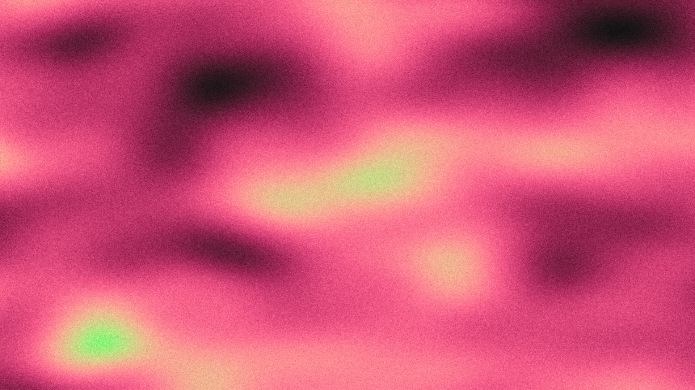 | 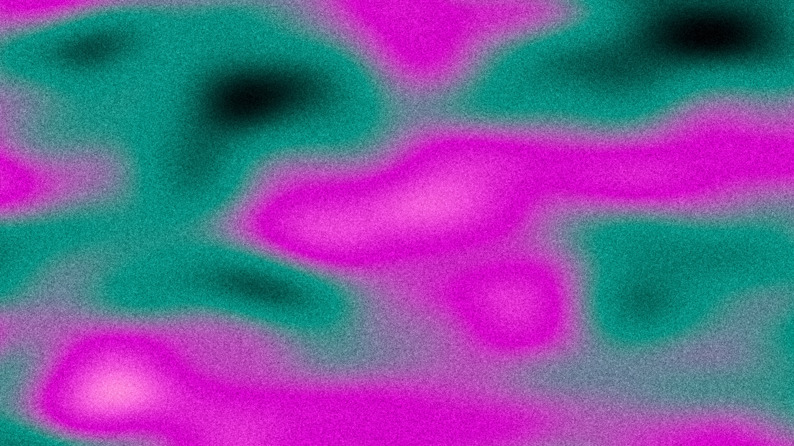 | 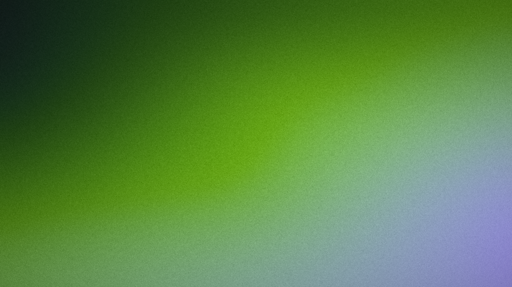 |
| Wide hue range, dark anchor | Neon palette, near-black | Luminous neon, frosted glass |

| Afterglow | Nocturne |
| :---: | :---: |
| 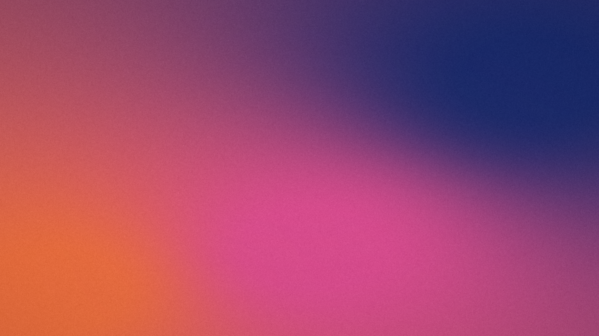 | 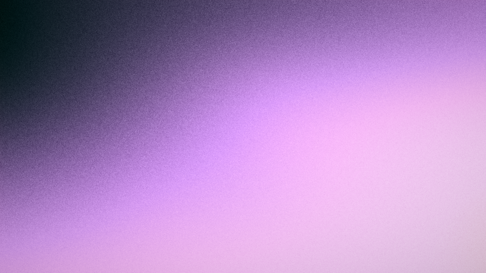 |
| Vivid violet, cyan, and ember fields | Twilight and ember on deep tints |

### Quiet and Minimal

| Ink | Nothing |
| :---: | :---: |
| 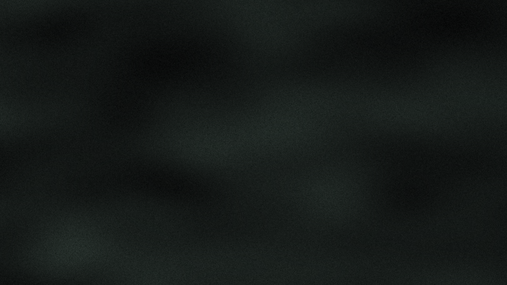 | 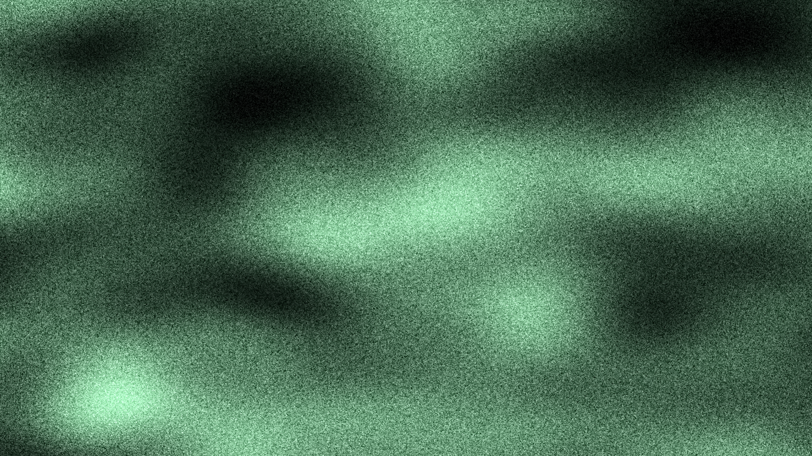 |
| Monochromatic near-black | Industrial dark, high-contrast accents and grain |

### Light and Soft

| Cupertino | Pastel |
| :---: | :---: |
| 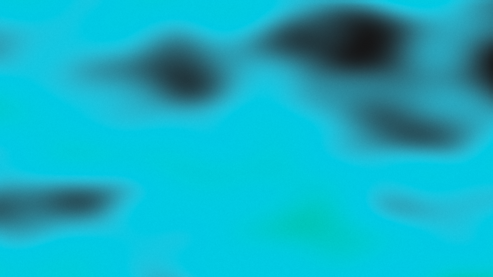 | 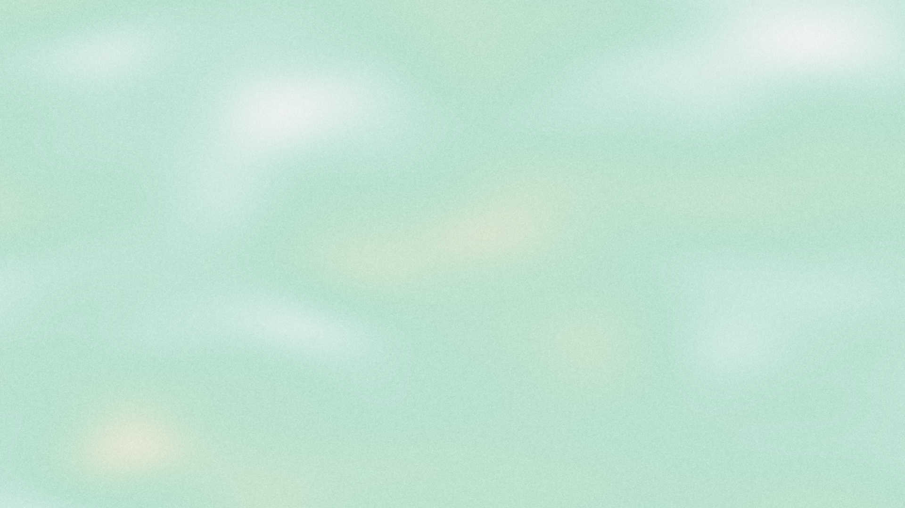 |
| Soft, muted light and dark | Light anchors, desaturated accents |

### Experimental

| Fractal |
| :---: |
| 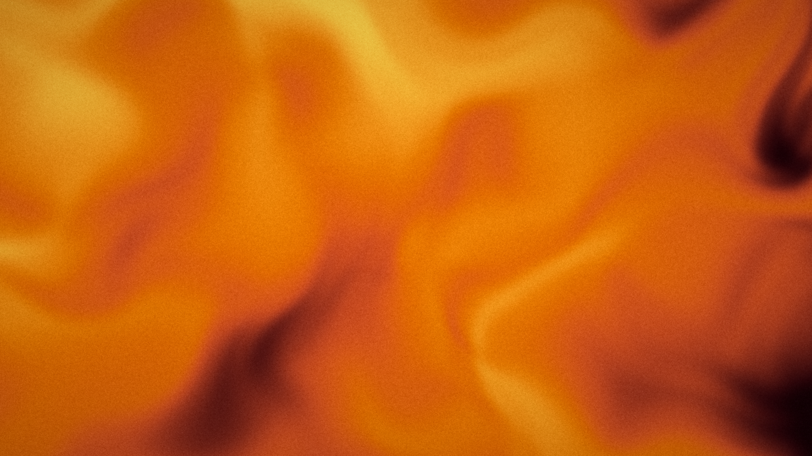 |
| Volumetric Julia sets, domain-warped folds |

## How It Works

Every wallpaper is three operations:

1. **Palette** — 2–5 harmonious OKLCH colors: a dark grounding anchor plus luminous accents, sampled from the preset's distributions (or your `--colors`, or the screen sampler).
2. **Field** — a procedural engine maps 2D coordinates through a mathematical field (domain warping, radial emitters, topography, fractals) and paints it through the palette.
3. **Finish** — optional surface effects: film grain, vignette, optional contour isobars, frosted glass, chromatic aberration.

Explore the [visual field guide](index.html) for controlled before/after comparisons and a real palette → field → finish walkthrough. The [architecture reference](docs/ARCHITECTURE.md) documents implementation and configuration.

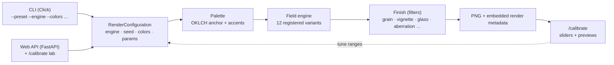

## CLI Reference

```bash
wp-generator --preset cyberpunk --res 1920 1080   # one-off size
wp-generator --preset pastel --count 10            # batch of 10
wp-generator --preset nothing --seed 42            # reproducible output
wp-generator --colors "#FF5000" --colors "#1A1A2E" # custom palette
wp-generator --sample                              # grab a color from the screen
wp-generator --metadata wallpaper.png             # inspect an existing render
```

Core flags: `--device`, `--count`, `--output`, `--out-dir`, `--workers`, `--preset`, `--colors` (repeat per color), `--sample`, `--metadata`/`--inspect`, `--json`. Everything else is an advanced engine/filter override, hidden from `--help` — run `--help-all` for the full list (`--seed`, `--res`, `--engine`, `--complexity`, `--fluid-mode`, `--harmonize`, `--noise`, `--contours`, `--glass`, and the fractal family).

### Device Presets (`--device`)

| Key | Resolution | Target |
| :--- | :--- | :--- |
| `mbp14` | 3024×1964 | MacBook Pro 14" |
| `mbp16` | 3456×2234 | MacBook Pro 16" |
| `mba13` | 2560×1664 | MacBook Air 13" |
| `mba15` | 2880×1864 | MacBook Air 15" |
| `1080p` | 1920×1080 | FHD Monitor |
| `1440p` | 2560×1440 | QHD Monitor |
| `4k` | 3840×2160 | UHD Monitor |
| `5k` | 5120×2880 | 5K Monitor |
| `uw` | 3440×1440 | Ultrawide (21:9) |
| `suw` | 5120×1440 | Super Ultrawide (32:9) |
| `mobile` | 1080×1920 | Smartphone Portrait |

## Presets

| Preset | Aesthetic |
| :--- | :--- |
| `balanced` | Wide hue range, dark anchor, vivid accents |
| `cupertino` | Soft, bimodal light/dark with muted tones |
| `cyberpunk` | Neon palette, near-black background |
| `ink` | Monochromatic near-black, minimal chroma |
| `nothing` | Industrial dark with high-contrast accent and film grain |
| `pastel` | Light anchors, desaturated accents |
| `afterglow` | Vivid reference-derived violet, cyan, coral, orange, and magenta fields |
| `sleek` | Luminous neon accents on dark anchor with frosted glass texture |
| `nocturne` | Deep richly-tinted grounding anchors paired with luminous twilight and ember accents |
| `fractal` | Volumetric dynamical Julia sets and fluid domain-warped folds |

Presets live in `presets/*.json` as OKLCH/HLS sampling distributions plus optional engine overrides and harmonization bounds. Any engine or filter flag on the CLI overrides the sampled value for that run.

## Engines

Twelve registered field variants in four mathematical families (`engine/gradients/`):

| Family | Engines |
| :--- | :--- |
| Directional sweeps + warping | `domain-warp`, `simplex`, `spline-wave`, `fluid-wave` |
| 2D point emitters | `rbf`, `radial-basis`, `flow-field`, `idw` |
| Harmonic elevation | `topographic` |
| Fractal fields | `fractal`, `fluid-fractal`, `escape-fractal` |

Select with `--engine`. `radial-basis` is an alias of `rbf`. The fractal names share a core: `fluid-fractal` fixes fluid mode, while `escape-fractal` selects Julia/Mandelbrot dynamics. The other sweep and point-emitter variants use different mathematics; grouping them does not make them interchangeable. Presets without an engine pin fall back to `simplex`.

## Filters

| Filter | Effect |
| :--- | :--- |
| Film grain | Two-scale grain with midtone weighting (`--noise`) |
| Vignette | Radial edge darkening (`--vignette`) |
| Contour isobars | Vector topographic lines, light/dark/accent (`--contours`, `--contour-levels`, `--contour-width`, `--contour-mode`) |
| Frosted glass | Diffusion blur + frost noise (`--glass`) |
| Chromatic aberration | Radial lens dispersion (`--aberration`) |
| Dither | Bounded monochromatic dither (defined, currently unwired) |

Use `--preview-fx` to compare the unfiltered base against the entire enabled finish stack (base left, finished render right). It does not isolate individual effects; the visual guide demonstrates those separately. Finish effects fall into three groups: texture (grain/dither), optical treatment (glass/aberration/vignette), and optional graphic contours.

## Web API

```bash
uv sync --extra web
uv run uvicorn web.app:app --reload   # calibrate lab at http://127.0.0.1:8000/calibrate
```

| Route | Purpose |
| :--- | :--- |
| `GET /calibrate` | Interactive effect and parameter-range lab |
| `GET /api/devices`, `GET /api/presets` | Device and preset catalogs with sample palettes |
| `GET / PUT /api/parameter-ranges`, `POST /api/parameter-ranges/reset` | Inspect, tune, and reset sampling ranges |
| `GET / POST /api/render` | Render a wallpaper (`preset`, `engine`, overrides, `harmonize`) |
| `POST /api/metadata/extract` | Read embedded render metadata from an image |
| `GET /health` | Health check |

Renders report WCAG contrast ratios of every accent against the palette anchor via `X-Render-Contrast-Ratios` / `X-Render-Contrast-Pass` headers; the CLI prints the same ratios. Blended pixels need separate evaluation for text placed over them.

## Development

```bash
git clone https://github.com/icherniukh/wp-generator && cd wp-generator
uv sync                                       # project env in .venv
uv run python main.py --preset cupertino      # run from the checkout
./install.sh                                  # macOS/Linux: global wp-generator wrapper that runs this checkout
```

## Testing

```bash
uv run python -m pytest tests/ -x -q
```
