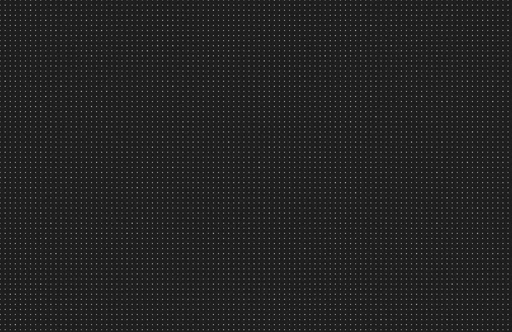
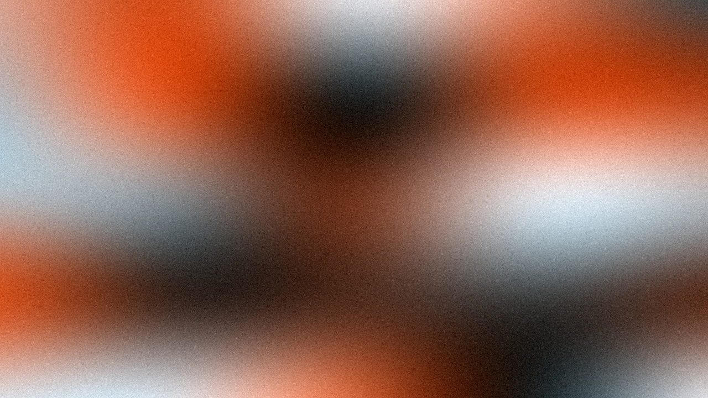
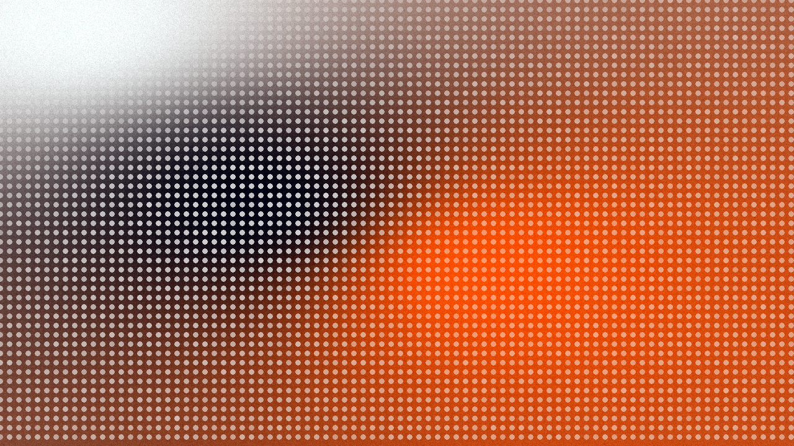
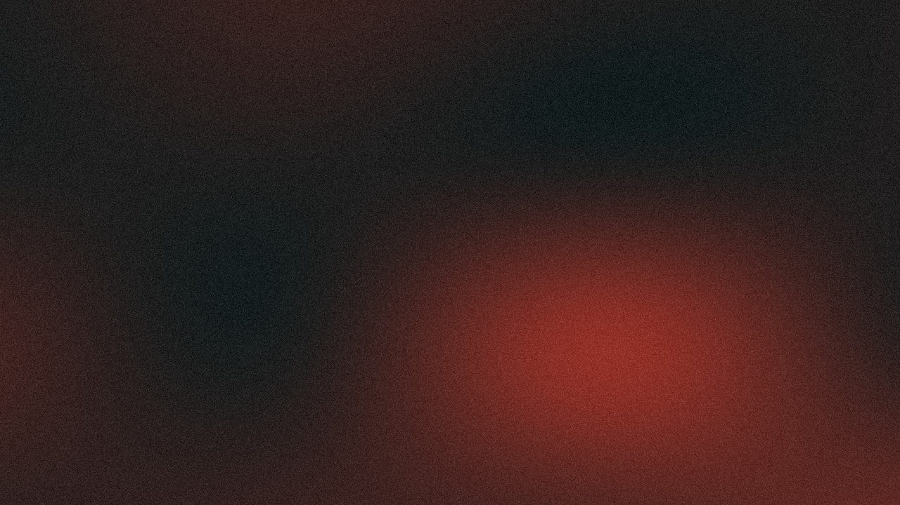
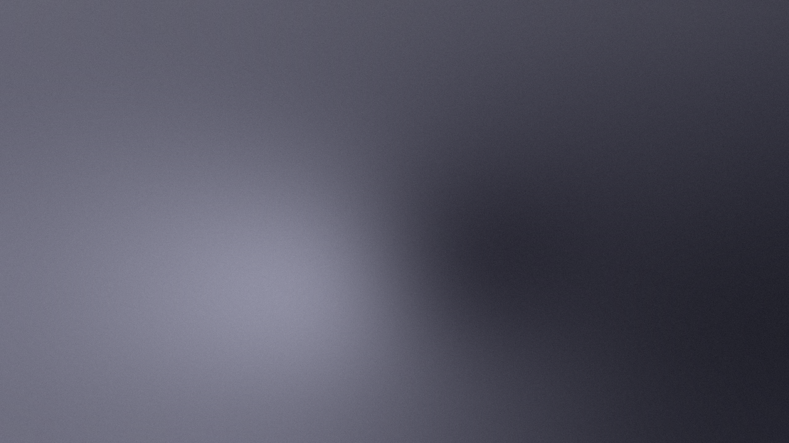
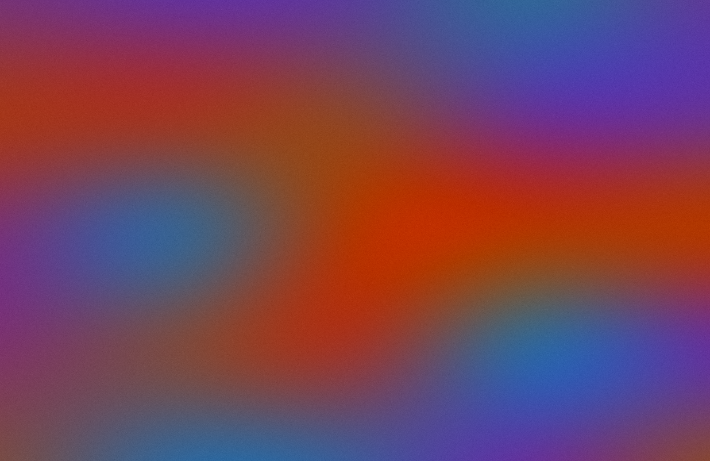

# Wallpaper Generator (macOS)

A procedural wallpaper generator designed for high-resolution Retina displays. It creates mesh-gradient wallpapers from generated palettes, explicit colors, or sampled screen colors, with an optional Nothing-inspired dot-matrix and color-harmonization style.

## 🚀 Key Features
- **Mesh Gradient Engine:** Uses fluid bicubic mesh interpolation by default, with an IDW legacy mode available.
- **Optional Style Filters:** Procedural dot-matrix overlays, monochromatic grain (noise), and frosted glass effects.
- **Color Harmonizer:** In optional Nothing-inspired mode, maps input colors with CIELAB LCH color science.
- **macOS Screen Sampler:** Retina-aware tool to grab colors directly from your screen at the mouse cursor.

## 🛠️ Installation
1. Ensure you have Python 3.12+ installed.
2. Clone this repository and navigate to the folder.

### Option 1: Global Install (Recommended)
We provide a helper script to install dependencies and create a global command `wp-generator` that you can run from anywhere:
```bash
./install.sh
```
*Note: This will ask for your password to create a symlink in `/usr/local/bin`.*

### Option 2: Manual Install
If you prefer not to install globally, just install the dependencies and run it locally:
```bash
pip install -r requirements.txt
```

## 📖 Usage
If you used the global install, simply type `wp-generator` from any directory. Otherwise, use `python main.py` inside the repo folder. By default, it generates a **3024x1964** wallpaper, sized for a 14-inch MacBook Pro.

### Visual CLI Examples

#### 1. The Classic Nothing Look (Dark Theme)
```bash
python main.py --nothing --theme dark --dots 0.8 --dots-spacing 25
```
*Effect: Deep charcoal mesh gradient with a technical dot grid modulated by luminance.*



#### 2. CMF Orange "Technical" Edition (Before & After Dots)
```bash
# Base gradient (left) vs. Alpha-modulated Dots (right)
python main.py --nothing --colors "#FF5000" --dots-mode alpha --dots-spacing 15
```
*Effect: Varies dot **opacity** rather than size over a smooth mesh gradient. Denser grid (15px) for an industrial feel.*




#### 3. High-Contrast Red (Phone 2a Style)
```bash
python main.py --nothing --theme red --noise 0.05 --dots 0.0 --complexity 3 --seed 42
```
*Effect: Deep, sweeping red and charcoal folds with heavy film grain to emphasize the "retro" display look.*



#### 4. The "Glass" Series (Frosted)
```bash
python main.py --nothing --theme glass --noise 0.01 --dots 0.0 --res 2560 1440
```
*Effect: Smooth, blurred translucent gradients with minimal noise, perfect for a clean desktop setup.*



#### 5. Generic Mesh Gradients (No Filters)
```bash
python main.py --colors "#FF00FF" "#00FFFF"
```
*Effect: Pure, vibrant mesh gradient without dots or brand-style color snapping.*



---

### CLI Options Reference
| Argument | Description | Default | Visual Impact |
| :--- | :--- | :--- | :--- |
| `--style` | Rendering style | `generic` | `generic` for neutral gradients, `nothing` for the optional Nothing-inspired pipeline. |
| `--nothing`| **Enable Nothing-inspired mode** | `False` | Enables dots, stronger noise, and color harmonization. |
| `--legacy-idw`| **Use Legacy Engine** | `False` | Uses Inverse Distance Weighting instead of Fluid Gradients. |
| `--theme` | Pre-defined aesthetic themes | `dark` | `dark`, `light`, `red`, `orange`, `glass` |
| `--colors` | Custom hex color list | (Theme) | Used directly in generic mode; harmonized in Nothing-inspired mode. |
| `--dots` | Dot intensity (0.0 - 1.0) | `0.8` | `1.0` = Bold/Sharp dots; `0.2` = Subtle texture |
| `--dots-mode` | Modulation type | `size` | `size` (Variable radius) vs `alpha` (Variable opacity) |
| `--dots-spacing`| Grid density (pixels) | `25` | `10` = Dense/Fabric; `50` = Minimal/Blueprint |
| `--noise` | Grain amount (0.0 - 1.0) | `0.03` | `0.05` = "Film" grain; `0.01` = Modern digital |
| `--res` | Resolution (W H) | `3024 1964`| `3024 1964` (14"), `3456 2234` (16") |
| `--complexity` | Gradient Pattern Complexity | `5` | `2` = Simple wide sweeps; `10` = Busy folds |
| `--sample` | Screen Color Sampler | `False` | Captures pixel at mouse cursor (3s delay) |
| `--no-adjust` | Raw Color Mode | `False` | Bypasses style color harmonization. |

---

### 🎨 The Aesthetic Logic
The generator uses a **Luminance-Aware Modulation** system:
- **Dots on Dark Areas:** Larger/More Opaque (emphasizes structure).
- **Dots on Light Areas:** Smaller/More Transparent (prevents clutter).
- **Colors:** In Nothing-inspired mode, color inputs are mapped toward a high-contrast industrial palette.
## 🧪 Aesthetic Philosophy
The generator can use the **CIELAB color space** to produce high-contrast or tightly monochrome results. Generic mode preserves the supplied colors more directly, while Nothing-inspired mode mutes backgrounds and keeps accent colors punchy.

---
*Created for MacBook M4 Pro.*
