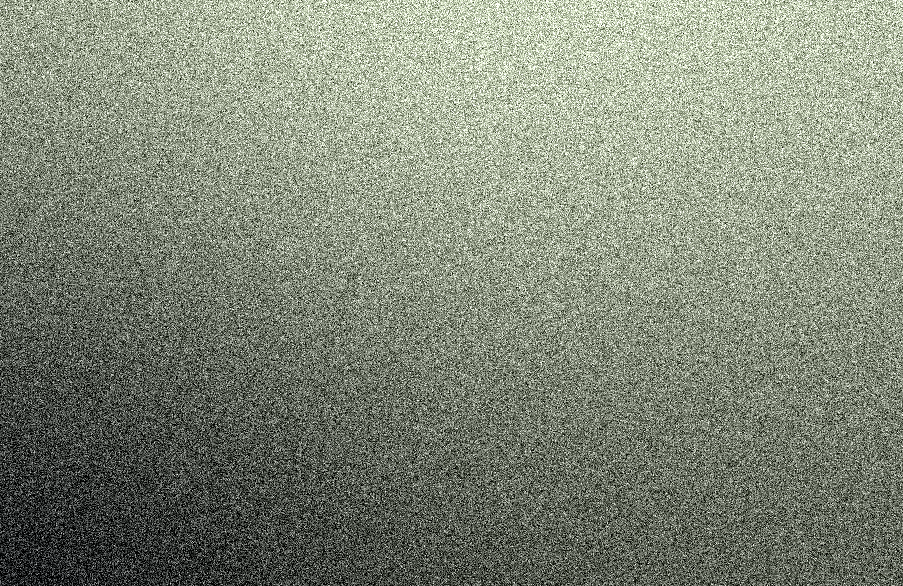
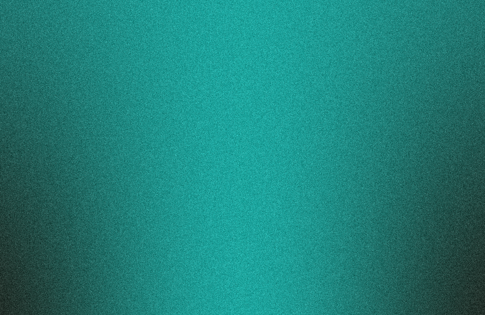
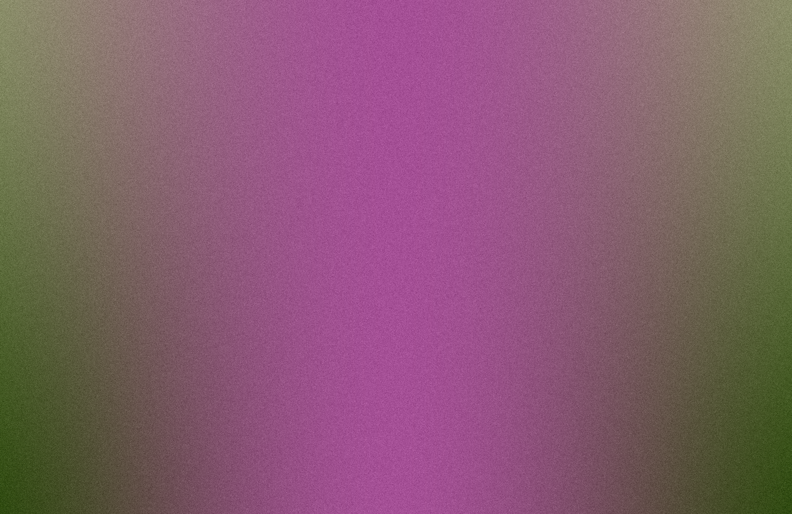

# Wallpaper Generator

A procedural wallpaper generator driven by a statistical preset engine. Each preset defines color palettes as probability distributions (Gaussian, Beta, Bimodal) in HLS color space — every run is statistically unique but aesthetically coherent. Outputs fluid mesh-gradient wallpapers at any resolution.

## Key Features

- **Statistical Preset Engine:** Presets encode color aesthetics as HLS distributions. The engine samples them at generation time — no two outputs are identical, but all stay within the preset's aesthetic envelope.
- **Fluid Mesh Gradient:** Bicubic mesh interpolation for smooth, high-quality gradients.
- **Style Filters:** Optional dot-matrix overlays and film grain, configurable per preset or via CLI overrides.
- **Color Harmonizers:** CIELAB-based Nothing-inspired mapping or color-theory harmonization.
- **Device Presets:** Common resolutions built-in — MacBook, 4K, ultrawide, mobile.
- **Screen Sampler:** Grab colors directly from the screen at the mouse cursor (macOS).

## Installation

1. Ensure Python 3.12+ is installed.
2. Clone this repository and navigate to the folder.

### Option 1: Global Install (Recommended)

```bash
./install.sh
```

Installs dependencies and creates a global `wp-generator` command. Requires sudo for `/usr/local/bin` symlink.

### Option 2: Manual

```bash
pip install -r requirements.txt
python main.py --preset cupertino
```

## Usage

### Basic Examples

```bash
# Preset-driven generation (statistical engine picks palette on every run)
python main.py --preset cupertino

# Target a specific display
python main.py --preset cyberpunk --device 4k

# Custom hex colors
python main.py --colors "#FF5000" "#1A1A2E"

# Batch — generate 10 variations of the same preset
python main.py --preset pastel --count 10

# Reproducible output
python main.py --preset nothing --seed 42
```

### Available Presets

| Preset | Aesthetic |
| :--- | :--- |
| `balanced` | Wide hue range, dark anchor, vivid accents |
| `cupertino` | Soft, bimodal light/dark with muted tones |
| `cyberpunk` | Neon palette, near-black background |
| `ink` | Monochromatic near-black, minimal chroma |
| `nothing` | Industrial dark with high-contrast accent and dot-matrix overlay |
| `pastel` | Light anchors, desaturated accents |

### Device Presets (`--device`)

| Key | Resolution | Target |
| :--- | :--- | :--- |
| `mbp14` | 3024×1964 | MacBook Pro 14" |
| `mbp16` | 3456×2234 | MacBook Pro 16" |
| `mba13` | 2560×1664 | MacBook Air 13" |
| `mba15` | 2880×1864 | MacBook Air 15" |
| `1080p` | 1920×1080 | FHD Monitor |
| `1440p` | 2560×1440 | QHD Monitor |
| `4k` | 3840×2160 | UHD Monitor |
| `5k` | 5120×2880 | 5K Monitor |
| `uw` | 3440×1440 | Ultrawide (21:9) |
| `suw` | 5120×1440 | Super Ultrawide (32:9) |
| `mobile` | 1080×1920 | Smartphone Portrait |

### Advanced Overrides

Run `--help-all` for advanced flags including `--complexity`, `--noise`, `--dots`, `--dots-spacing`, `--fluid-mode`, `--harmonize`, `--res`, and `--seed`.

```bash
python main.py --help-all
```

### Sample Outputs




