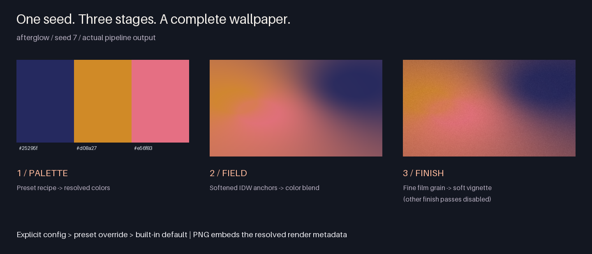
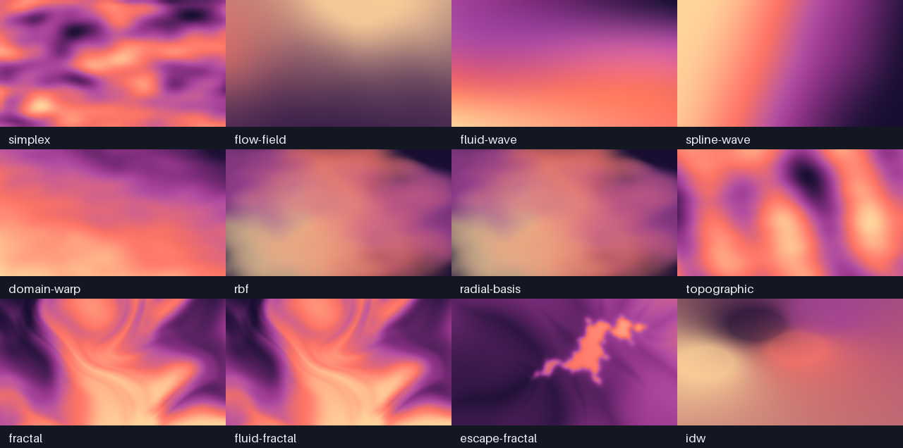

# Architecture: What Exists Today

Every render is three operations: **palette → field → finish**. This document
describes the code that implements each stage as it stands. The [visual guide](../index.html) demonstrates each stage. Future configuration
consolidation is tracked separately; the draft `engines/*.json` layer is not
consumed by the pipeline.

## Render Pipeline (`engine/pipeline.py`)

`WallpaperPipeline.render(config)` takes a `RenderConfiguration` and:

1. Resolves the engine name (explicit `--engine`, else preset override, else `simplex`).
2. Resolves every other parameter in precedence order: **explicit CLI flag >
   preset override > built-in sampling** (`PARAMETER_RANGES` or hardcoded
   defaults). Engine-specific warp sampling goes through `warp_key_map`
   (`rbf`/`radial-basis` → `rbf_warp`, `topographic` → `topo_warp`,
   `flow-field` → `flow_warp`, `spline-wave` → `spline_warp`, else
   `warp_strength`).
3. Builds the palette (`_resolve_palette` → `_harmonize_palette`).
4. Renders the field via `render_gradient` from the registry.
5. Applies finish filters, embeds `ImageMetadata`
   (`build_image_metadata`), writes PNG.

`random.seed` / `np.random.seed` on the active seed make every run reproducible.

## Primitives Inventory

All rendered with one palette and one seed, so the grid shows math, not color luck:

### 1. Base Canvas Generators (`engine/gradients/`, 11 classes, 12 registry keys)

Grouped by mathematical family, not presented as twelve independent algorithms.
`radial-basis` is an exact alias of `rbf`. The three fractal classes share one
core; the wrappers restrict its mode to fluid or escape-time dynamics. Sweep
and emitter variants remain distinct where their mathematics differs:

| Family | Classes | Registry keys |
| :--- | :--- | :--- |
| Directional sweeps + warping | `DomainWarpGradient` (field.py), `SimplexMeshGradient` (mesh.py), `SplineWaveGradient` (spline.py), `FluidMeshGradient` (mesh.py) | `domain-warp`, `simplex`, `spline-wave`, `fluid-wave` |
| 2D spatial point emitters | `RadialBasisGradient` (field.py), `FlowFieldGradient` (field.py), `MeshGradient` (mesh.py, legacy IDW) | `rbf`, `radial-basis`, `flow-field`, `idw` |
| Harmonic elevation | `TopographicGradient` (field.py) | `topographic` |
| Fractal fields | `FractalFieldGradient` + `FluidFractalGradient` + `EscapeTimeFractalGradient` (fractal.py) | `fractal`, `fluid-fractal`, `escape-fractal` |

`engine/gradient.py` is a backwards-compatibility facade re-exporting the registry.

### 2. Spatial & Noise Primitives (`engine/gradients/spatial.py`)

`generate_noise_plane`, `warp_coordinates_perlin`, `trig_fbm_field`,
`normalize_scalar_field`, `random_anchor_points`.

### 3. Field-to-Color Mapping (`engine/gradients/interpolation.py`)

`interpolate_color_curve` (Oklab PCHIP spline), `evaluate_decoupled_palette`
(separate lightness/chroma fields), `interpolate_oklab`, plus conversion and
validation helpers (`colors_to_oklab`, `oklab_image_to_pil`,
`validate_palette_colors`).

### 4. Palette Generation & Harmonization

- `PresetEngine` (`engine/presets.py`): `load_preset`, `get_preset_version`,
  `sample_distribution` (uniform / uniform_int / gaussian / beta / bimodal /
  relative), `generate_palette` (statistical anchor + relative-hue accents, or
  curated families), `get_engine_overrides`.
- `WallpaperPipeline._sample_dynamic_palette`: HLS fallback when no preset
  or colors are given.
- `StyleHarmonizer.adjust_for_nothing` (`engine/colors.py`): muted/vivid
  Nothing-style clamping.
- `ColorTheoryHarmonizer.harmonize` (`engine/colors.py`): modes
  `perceptual`, `theory`, `triadic` and other classical chords, with `theory` resolved through the preset by the pipeline. `nothing` / `none`
  are pipeline modes; OKLCH gamut mapping uses `oklch_to_rgb_clamped`
  (see `clamp_oklch`). Contrast reporting via `relative_luminance` /
  `contrast_ratio`.

### 5. Finish Effects (`engine/filters.py`, `WallpaperFilters`)

Five wired into the pipeline in order: `apply_contour_lines`,
`apply_frosted_glass`, `apply_chromatic_aberration`, `apply_film_grain`,
`apply_vignette`. Grouped by purpose: texture (grain/dither), optical finishes
(glass/aberration/vignette), and optional graphic contours. `apply_dither` exists but is currently
unwired. `--preview-fx` renders the raw mesh beside the finished image to
isolate the finish layer.

## Configuration Layers (Current)

Four overlapping layers own "what runs and with what bounds" — this overlap
is the known problem the refactor addresses:

1. `presets/*.json` — OKLCH/HLS distributions + engine overrides (10 presets;
   4 pin an engine: fluid-wave ×2, fractal, idw).
2. `engine/presets.py` — distribution sampler + override extractor.
3. `engine/parameter_ranges.py` — `ParameterRangeStore` (`load`, `save`,
   `reset_defaults`, `update_ranges`, `get`) backing the `/calibrate` sliders.
4. `RenderConfiguration` — flat render options. `transverse_warp` has no CLI
   flag, but config, preset overrides, and the web API can supply it; otherwise
   it is sampled.

## Interfaces

- **CLI** (`main.py`, Click): flags mirror config fields 1:1; core flags in
  `--help`, everything else `hidden=True` under `--help-all`.
- **Web** (`web/app.py`): preset/device catalogs, `/api/parameter-ranges`
  (get/put/reset), `/api/render` (GET/POST), `/api/metadata/extract`,
  `/health`, and the `/calibrate` lab.
- **Render metadata**: `ImageMetadata` (`engine/metadata.py`) embedded in
  every PNG; `X-Render-Contrast-*` headers on web renders.
